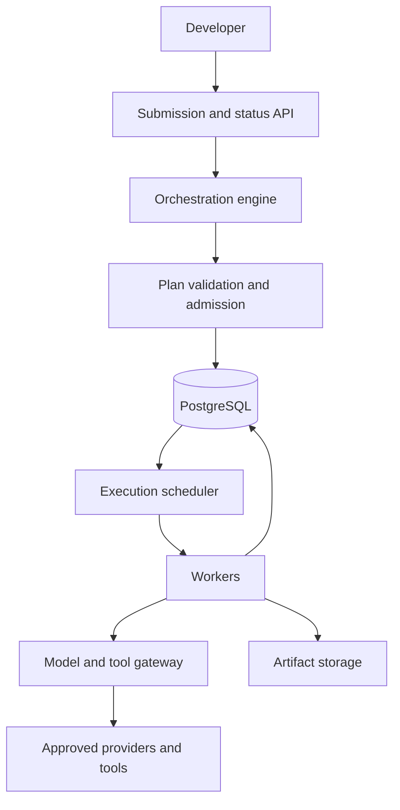

# Architecture

## Boundary

The orchestration engine interprets requests, proposes versioned plans, selects
agent implementations, assembles context, and synthesizes evidence. It cannot
directly authorize tools, spend money, or change execution state.

The execution environment validates and persists plans, schedules tasks, owns
attempts and leases, enforces policy, reserves budgets, and publishes artifacts.
Agent code runs through the same execution contract as deterministic tasks.

## Initial deployment

One Python repository with separately runnable API, scheduler, and worker
processes. PostgreSQL is the authoritative execution store and initial work queue.
Local artifact storage uses an interface later backed by Azure Blob Storage.
FastAPI, Docker Compose, and OpenTelemetry will be introduced with runtime code.
No Redis, broker, Kubernetes, or vector database is required for the initial scope.

## Submission and execution

1. Persist a developer request with a client idempotency key and input hash.
   Repeating the same key and input returns the same run; different input conflicts.
2. Execute planning as a bounded, recorded operation. A planner failure is visible
   as a failed run; planning is not an untracked prelude to execution.
3. Validate the entire plan and store it atomically with tasks and dependencies.
   A failed admission creates no executable tasks.
4. A scheduler makes dependency-satisfied tasks ready. Workers claim tasks with
   expiring leases and monotonically increasing fencing tokens.
5. Each model or tool operation goes through admission for permission and budget.
6. Workers persist outputs and commit completion under a valid lease. Scheduling
   uses committed database state, never worker-local observations.
7. Evidence review and report writing are explicit tasks with artifact inputs.
   A run succeeds only when every task in its accepted plan succeeds.

Version 1 accepts a single immutable plan revision per run. Replanning requires a
new run; plan revision migration and dynamic graph expansion are deferred.
The planner itself is represented by the run's PLANNING phase, with recorded
operations subject to the same gateway and accounting rules as task operations.

## Persistent records planned for milestone 1

| Record | Purpose and important constraints |
| --- | --- |
| Run | Request, state, accepted plan, deadline, cancellation timestamp; unique owner/client key |
| Task | Run-scoped ID, state, next eligible time; unique run/task ID |
| Dependency | Run-scoped task edges; validated acyclic graph |
| Attempt | Task, attempt number, lease owner/expiry, fencing token, outcome |
| Operation | Stable logical operation ID, request hash, provider request ID, outcome |
| Budget reservation | Run and operation ID, reserved amount, settlement status |
| Usage ledger | Immutable charges and adjustments linked to operation and reservation |
| Artifact | Immutable content hash, storage reference, media type, provenance |
| Event | Run sequence, timestamp, actor, state change, correlation identifiers |
| Approval | Exact action digest, approver, expiry, consumption status |

Attempt completion, task transition, event append, and dependency eligibility must
commit in one transaction. Large artifacts are written first; only committed
metadata exposes them. Orphaned uploads are garbage-collected after a grace period.
Budget settlement may arrive separately and must remain idempotent.

## Context and evidence

Tasks receive explicit input artifact references and bounded instructions, not
the entire conversation history. An input snapshot records artifact hashes,
agent/prompt versions, model configuration, policy version, and tool versions.
Findings carry source artifact IDs and locators. Evidence review returns conflicts
with claim IDs and resolution status. Reports cite findings and retain unresolved
conflicts. Summaries are derived artifacts and never replace original evidence.

## Observability

Every event links run, task, attempt, and operation IDs where applicable. Capture
queue latency, execution latency, retry counts, lease expiry, reservations, actual
usage, and policy denials. Store structured outputs for execution replay with
sensitive-data controls. A fresh model call is an evaluation rerun, not replay.
